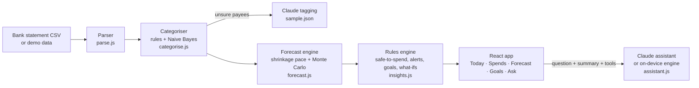

# PocketRunway

[](https://github.com/varunsh1812-arch/pocketrunway/actions/workflows/ci.yml)
[](https://vercel.com/new/clone?repository-url=https://github.com/varunsh1812-arch/pocketrunway)

**Know if your money will last the month, before it runs out.**

PocketRunway is an AI-powered budgeting app for students and first-time earners who live on a fixed monthly allowance or salary. It reads a bank statement, tags every spend, forecasts the day the money runs out, and turns all of it into one number: what you can safely spend today.

Group 8 · Innovation & Entrepreneurship · Assignment 2 (prototype).

**Live prototype:** https://claude.ai/artifact/WS6LPZeZMU7opqL2BkGFfD (a Claude artifact: share it from its Share menu before sending the link; inside Claude the assistant is powered by Claude). For a public URL anyone can open, drag the `dist` folder onto Netlify Drop (see Deploy).

---

## What it does

| Screen | What you get |
|---|---|
| **Today** | Safe-to-spend today, the runway bar (Day 1 → the day money runs out → next allowance), plain-language alerts and a "Fix it" lever (skip N food orders → new runout day). |
| **Spends** | Every transaction tagged by category, this month vs your usual by the same day, and a review queue for payees the model has never seen. Tap any tag to correct it; the model learns instantly. |
| **Forecast** | Balance chart with the expected path and an 80% likely range, bills still to come, how the model works and a backtest on your own past months. |
| **Goals** | Savings goals with the weekly amount needed. Plain rules, no AI. |
| **Ask** | "Why am I low?", "Can I afford a ₹1,200 ticket?", "What if I skip 4 Swiggy orders?". Answered by Claude with the app's tools when the app runs inside Claude, and by an on-device engine everywhere else. |

The demo opens on **Riya** (fictional): a 2nd-year student on a ₹12,000 allowance, Day 12 of September. Her statement is synthetic: five months of realistic student UPI spends generated by `src/engine/synth.js`. You can import your own CSV statement from the data sheet; it never leaves the browser.

## Where the AI is (and isn't)

| Job | Method | Measured |
|---|---|---|
| **Categorise spends** | Brand rules (Swiggy, Blinkit, Rapido…) → keyword rules ("canteen", "xerox", "medical") → multinomial **Naive Bayes** on word + character n-grams of the payee. Unknown payees are held out for review or sent to Claude. User corrections retrain the model immediately. | **94% accuracy, macro-F1 0.88** on 150 payees the model never saw (merchant-level split). |
| **Forecast the month** | Recurring-bill detection + an everyday pace that blends this month with your decayed history (empirical-Bayes shrinkage), day-of-week multipliers, and a **Monte Carlo** bootstrap of your own past days (1,500 runs) for the likely range. Days when you'd already run out are excluded from fitting. | Backtest on 4 past months (stand on Day 12, predict the runout day): **±1.5 days** vs ±2.5 days for a naive "spent so far" rule. |
| **Explain** | Claude via the artifact `sample` capability with 4 page tools (`simulate_purchase`, `simulate_cut`, `spend_by_category`, `list_transactions`). The prompt carries only computed summaries. | Grounded: every number comes from the app's own calculations. |
| **Not AI** | Safe-to-spend formula, alerts, goals, budget rules. | Deterministic and explainable by design. |

Safe-to-spend today = (balance at the start of today − bills still due this cycle − buffer) ÷ days left including today, rounded down to ₹10.

## Architecture



```
src/engine/   pure JavaScript, no dependencies, fully unit-tested
  util.js        dates, seeded RNG, money formatting
  taxonomy.js    categories, brand + local-merchant knowledge
  parse.js       CSV + Indian date/amount formats + UPI narrations
  categorise.js  rules, Naive Bayes, evaluation, learning from corrections
  forecast.js    budget cycle, balances, recurring bills, model fit, projection, Monte Carlo, backtest
  insights.js    safe-to-spend, category pace, alerts, goals, what-ifs
  assistant.js   on-device intent engine, Claude prompt + tools
  synth.js       Riya's synthetic statement
src/ui/       React UI (App.jsx, parts.jsx, claude.js); styles.css imports tokens.css (the Coral palette, type and spacing tokens) and base.css
tests/        node:test suite (18 tests), run in CI on every push
scripts/      build.mjs (esbuild), export-sample.mjs, calibrate.mjs (picks the demo seed)
sample-data/  synthetic statements in HDFC and SBI layouts to try the import
dist/         built app: index.html (self-contained) and artifact.html
```

## Run it

```bash
npm install
npm test          # 18 engine tests
npm run build     # writes dist/index.html and dist/artifact.html
open dist/index.html
```

No server, no API keys, no database: the whole app is one static page.

## Deploy (pick one)

- **Netlify Drop (fastest):** drag the `dist` folder onto https://app.netlify.com/drop.
- **Vercel:** click **Deploy with Vercel** above (uses `vercel.json`: `npm run build`, output `dist`), or run `npx vercel --prod` in this folder.
- **Netlify from Git:** connect the repo; `netlify.toml` already sets `npm run build` and `dist`.
- **GitHub Pages:** turn on Settings > Pages > Source: GitHub Actions, then run the **Deploy to GitHub Pages** workflow from the Actions tab.
- **Any static host or USB stick:** `dist/index.html` is a single self-contained file.

Outside Claude, the assistant answers with the on-device engine. Inside a Claude artifact it upgrades to Claude automatically.

## Importing a statement

Export your statement as CSV (or save the Excel export as CSV). The parser finds the header row and needs a date column plus either an amount column (signed, or with a Dr/Cr type column) or separate debit and credit columns. A balance column is used when present; otherwise you enter today's balance. Dates like `12/09/26`, `12-Sep-2026`, `12 Sep 2026` and `2026-09-12` all work, as do newest-first statements. Try the files in `sample-data/`.

## Privacy and safeguards

- Statements are parsed and analysed in the browser; nothing is uploaded or stored on a server.
- Settings and corrections are kept in this browser's local storage only.
- The assistant sends Claude a summary of computed numbers, and only after the viewer allows it.
- Budgeting guidance only: the assistant is instructed not to give investment, credit or insurance advice.
- A real launch would connect accounts through RBI's Account Aggregator framework with explicit consent, in line with the DPDP Act 2023 and DPDP Rules 2025.

## Limits and next steps

- Synthetic demo data; the next step is testing with 5–10 students on real statements.
- CSV import only (PDF statements and Account Aggregator are on the roadmap).
- Forecast assumes no unplanned income; a top-up simply moves the runout date in the next refresh.
- Categoriser is tuned to Indian student spending; a larger labelled dataset would lift the Naive Bayes layer.

MIT licence.
